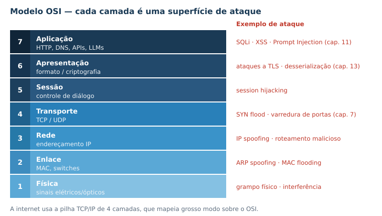

# Capítulo 3 — Fundamentos Pré-Invasão e Tecnologias de Suporte

> Você não ataca o que não entende. Este capítulo é a base técnica sobre a qual
> todo o resto se apoia: como as máquinas conversam (TCP/IP), como se organiza
> essa conversa (modelo OSI, portas), e quais ferramentas intelectuais — inglês
> técnico e Python — multiplicam sua capacidade.

## 3.1 O princípio fundamental: compreender o alvo antes de atacar

Há uma assimetria cruel na segurança: o defensor precisa proteger tudo; o
atacante precisa achar *uma* falha. Mas essa assimetria só funciona a favor do
atacante que **entende o sistema**. O *script kiddie* dispara *exploits* sem saber
o que faz; o profissional primeiro constrói um **modelo mental do alvo** — o que
ele é, como se comunica, de que depende — e só então ataca, cirurgicamente.

Compreender o alvo significa, no mínimo, responder:

- Que sistema operacional ele roda? (determina *exploits*, caminhos, *shells*)
- Que serviços expõe e em que versões? (cada versão tem suas falhas conhecidas)
- Como ele se encaixa na rede? (há firewall? proxy? segmentação?)
- De que ele depende? (banco de dados, API externa, fornecedor — a "cadeia de
  suprimentos", que na Parte V é um vetor central de ataque a IA)

Tudo isso é a Parte III deste livro (reconhecimento, mapeamento, análise de
vulnerabilidades). Mas para *interpretar* o que você descobre, precisa dos
fundamentos que vêm a seguir.

## 3.2 Arquitetura de redes: o modelo OSI

O modelo **OSI (Open Systems Interconnection)** divide a comunicação em sete
camadas. Ele é um mapa conceitual: cada camada tem uma responsabilidade e
"conversa" com a camada equivalente do outro lado. Para o atacante, cada camada é
uma superfície de ataque distinta.

| Camada | Nome | Função | Exemplo de ataque |
|---|---|---|---|
| 7 | Aplicação | Protocolos que o usuário vê | SQL Injection, XSS, *Prompt Injection* (Cap. 11) |
| 6 | Apresentação | Formato/criptografia dos dados | Ataques a TLS, desserialização insegura (Cap. 13) |
| 5 | Sessão | Controle de diálogo | Sequestro de sessão (*session hijacking*) |
| 4 | Transporte | Entrega fim-a-fim (TCP/UDP) | SYN flood, varredura de portas (Cap. 7) |
| 3 | Rede | Endereçamento e roteamento (IP) | IP spoofing, roteamento malicioso |
| 2 | Enlace | Comunicação local (MAC, switches) | ARP spoofing, MAC flooding |
| 1 | Física | Sinais elétricos/ópticos | Grampo físico, interferência |

> 💡 **Dica Técnica:** Memorize a camada de cada ataque que você aprender. Quando
> alguém disser "ataque de camada 7", você deve pensar imediatamente em
> aplicação (HTTP, DNS, APIs — e hoje, LLMs). Essa taxonomia organiza o
> pensamento e aparece em todo *briefing* de segurança sério.



Na prática, a internet roda sobre uma pilha mais enxuta — o modelo **TCP/IP**,
de quatro camadas (Aplicação, Transporte, Internet, Acesso à Rede) — que mapeia
grosso modo sobre o OSI. É esse que você vai usar no dia a dia.

## 3.3 TCP/IP na prática

### Endereço IP

Todo dispositivo numa rede tem um **endereço IP**. O IPv4 é um número de 32 bits
escrito em quatro octetos: `192.168.0.10`. Ele responde "onde" está a máquina.

### A tríade de identificação

Para conversar com um serviço específico, você precisa de três coisas — e não é
coincidência que elas espelhem a **Técnica dos Três Pontos** do livro:

1. **IP** — qual máquina (camada 3).
2. **Porta** — qual serviço naquela máquina (camada 4).
3. **Protocolo** — qual "idioma" o serviço fala (camada 7).

### TCP vs. UDP

A camada de transporte tem dois protocolos principais:

| Característica | TCP | UDP |
|---|---|---|
| Conexão | Orientado à conexão (*handshake*) | Sem conexão |
| Confiabilidade | Garante entrega e ordem | Não garante (dispara e esquece) |
| Velocidade | Mais lento (overhead) | Mais rápido |
| Usos típicos | HTTP(S), SSH, FTP, bancos de dados | DNS, DHCP, VoIP, jogos, streaming |

### O *three-way handshake* do TCP

É o ritual de abertura de toda conexão TCP — e a base de praticamente toda
varredura de portas (Capítulo 7):


Entender esse diálogo é o que permite compreender a varredura **TCP SYN**
(`nmap -sS`): o atacante envia o SYN, recebe o SYN-ACK (que já prova que a porta
está aberta) e **não completa** o handshake — economizando tempo e deixando menos
rastros. É o chamado *half-open scan*. Guardaremos isso para o Capítulo 7; aqui
basta entender *por que* ele funciona.

## 3.4 Portas lógicas

Uma **porta** é um número de 16 bits (0 a 65535) que identifica um serviço dentro
de uma máquina. Se o IP é o endereço do prédio, a porta é o número do
apartamento. Elas se dividem em:

- **Well-known (0–1023):** serviços padronizados.
- **Registradas (1024–49151):** atribuídas a aplicações específicas.
- **Dinâmicas/efêmeras (49152–65535):** usadas temporariamente por clientes.

As portas que você mais encontrará — e que precisa reconhecer de imediato:

| Porta | Protocolo | Serviço | Relevância ofensiva |
|---|---|---|---|
| 21 | TCP | FTP | Credenciais em texto claro, acesso anônimo (Cap. 8/9) |
| 22 | TCP | SSH | Força bruta de credenciais, acesso remoto (Cap. 9) |
| 23 | TCP | Telnet | Texto claro; presença já indica sistema legado/inseguro |
| 25 | TCP | SMTP | Enumeração de usuários, *open relay* |
| 53 | TCP/UDP | DNS | Enumeração, transferência de zona |
| 80 | TCP | HTTP | Toda a superfície web (Cap. 8) |
| 110/143 | TCP | POP3/IMAP | Credenciais de e-mail |
| 443 | TCP | HTTPS | Web sobre TLS; APIs — inclusive de IA (Cap. 11) |
| 445 | TCP | SMB | Compartilhamento Windows; alvo histórico de *worms* |
| 3306 | TCP | MySQL | Banco de dados exposto |
| 3389 | TCP | RDP | Área de trabalho remota; alvo clássico de *ransomware* |
| 8080 | TCP | HTTP alt. | Proxies, painéis, APIs internas |

> ⚠️ **Atenção:** "Porta aberta" não é sinônimo de "vulnerável", e "porta
> fechada/filtrada" não é sinônimo de "seguro". A porta é só o começo da
> conversa. A vulnerabilidade está no *serviço* que atende aquela porta, na
> *versão* dele e na *configuração*. Confundir isso faz você perder horas atacando
> portas abertas mas robustas, ignorando o serviço mal configurado ao lado.

## 3.5 O inglês instrumental técnico

Não é um detalhe cultural — é uma ferramenta operacional. A esmagadora maioria
do conhecimento de ponta em segurança nasce em inglês:

- **Documentação e *man pages*:** `man nmap` está em inglês; as RFCs que definem
  os protocolos estão em inglês.
- **Bases de vulnerabilidade:** CVE, Exploit-DB, avisos de fabricantes
  (Capítulo 8) — tudo em inglês.
- **Mensagens de erro:** você vai pesquisar o erro literal no buscador; saber
  lê-lo poupa horas.
- **Frameworks de IA:** OWASP Top 10 for LLM, NIST AI RMF, documentação de
  bibliotecas (Capítulos 11–15) — nativamente em inglês.

Você não precisa ser fluente em conversação. Precisa de **leitura técnica**:
entender documentação, erros e avisos de segurança. É uma habilidade que se
treina lendo `man` de ferramentas e avisos de CVE todos os dias.

> 💡 **Dica Técnica:** Adote o hábito de ler a *man page* completa de cada
> ferramenta nova antes de usá-la "no muque". `man nmap`, `man hping3`,
> `medusa -h`. Metade das "descobertas" que impressionam em segurança é apenas
> alguém que leu a documentação até o fim.

## 3.6 Programação em Python como alavanca

Você *pode* fazer muita coisa só com ferramentas prontas. Mas o teto do seu
crescimento é definido pela sua capacidade de **automatizar, adaptar e criar**. E
a língua franca disso em segurança é **Python**.

Por que Python domina a segurança ofensiva e defensiva:

- **Sintaxe legível:** você lê e adapta *exploits* de terceiros rapidamente.
- **Bibliotecas de rede:** `socket` (conexões cruas), `scapy` (fabricar e
  injetar pacotes), `requests` (HTTP/APIs).
- **É a língua da IA:** praticamente todo o ecossistema de *machine learning* —
  e portanto toda a Parte V deste livro — é Python. As bibliotecas de defesa de
  modelos (CleverHans, IBM ART), o perigo do `pickle` e a solução `safetensors`
  (Capítulo 13) são todos Python.

Um exemplo mínimo que já mostra a potência: um verificador de portas em ~15
linhas, usando apenas a biblioteca padrão. Rode-o **apenas** contra alvos do seu
laboratório (Capítulo 5):

```python
#!/usr/bin/env python3
# scanner_simples.py — verifica se portas TCP estao abertas num alvo.
# USE SOMENTE EM ALVOS AUTORIZADOS / SEU LABORATORIO.
import socket

alvo = "127.0.0.1"                 # troque pelo IP do SEU laboratorio
portas = [21, 22, 80, 443, 3306]   # portas de interesse

for porta in portas:
    s = socket.socket(socket.AF_INET, socket.SOCK_STREAM)
    s.settimeout(0.5)              # nao espera para sempre por porta fechada
    resultado = s.connect_ex((alvo, porta))  # 0 = conexao bem-sucedida
    estado = "ABERTA" if resultado == 0 else "fechada/filtrada"
    print(f"Porta {porta:>5}/tcp: {estado}")
    s.close()
```

Note que esse script faz um *full connect* (completa o handshake), diferente do
`nmap -sS`. Entender essa diferença — por que o `connect_ex` deixa mais rastro
que o SYN scan — é exatamente o tipo de compreensão que Python permite, porque
você vê o mecanismo, não só o resultado.

> 💡 **Dica Técnica:** Não tente "aprender Python inteiro" antes de começar.
> Aprenda o suficiente para ler um *exploit*, entender um *script* de rede e
> escrever automações pequenas. A profundidade vem com a prática dirigida a
> problemas reais de segurança — e a Parte V vai exigir confortável fluência em
> ler código Python de *machine learning*.

---

### Resumo do capítulo
- Entender o alvo (SO, serviços, versões, dependências) precede qualquer ataque sério.
- O modelo OSI organiza ataques por camada; a internet roda sobre a pilha TCP/IP de 4 camadas.
- A tríade IP + Porta + Protocolo é a base da comunicação — e espelha a Técnica dos Três Pontos.
- O *three-way handshake* do TCP é a base da varredura de portas; TCP garante entrega, UDP é "dispara e esquece".
- Inglês técnico (leitura) e Python (automação) são multiplicadores de capacidade e indispensáveis na Parte V.

### Para fixar
1. Desenhe, de memória, o *three-way handshake* e explique por que o SYN scan não precisa do terceiro pacote.
2. Rode o `scanner_simples.py` contra `127.0.0.1` e depois compare mentalmente seu comportamento com o que o `nmap -sS` faria. O que cada um deixa de rastro?
